<div align="center">

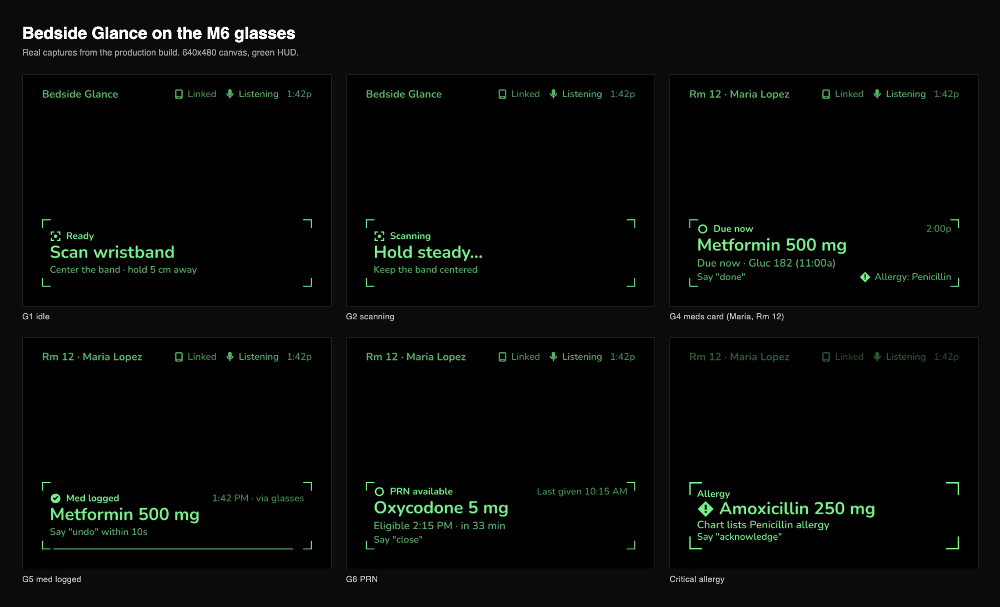

# Bedside Glance

**The right patient, the right drug and the allergy warning in a nurse's line of sight, hands free, charted to the phone in one tap or word, and handed to the next nurse without the two devices ever disagreeing.**

Status: working prototype, built Nov 20-21, 2026 | Tests: 826 passing (73 files) | Real M6 glasses: not yet verified | Data: synthetic only | Not a medical device

</div>

Glance on the glasses, depth on the phone. Built for the Worn Smart Glasses Hackathon (track: Seamless Handoff) for the MicroLumin M6 glasses (640x480 see-through display, Android 9) plus a phone.

**Contents:** [Three moments](#three-moments) | [Product](#product) | [Engineering](#engineering) | [Teammate workflow](#teammate-workflow) | [Business and go-to-market](#business-and-go-to-market) | [Clinical and institutional context](#clinical-and-institutional-context) | [Measured and unmeasured](#measured-and-unmeasured) | [Known limitations](#known-limitations) | [Reviewer FAQ](#reviewer-faq) | [Docs index](#docs-index) | [Repo map](#repo-map)

## Honest status

- **Built and tested:** one Vite + React + TypeScript app and one Node server. 826 tests pass in 73 files (`npm run check`, 2026-11-21; the 6 static-serving tests skip when no `dist/` build exists, so a bare `npm test` before a build shows 820 passed and 6 skipped). Coverage from `npm run coverage` the same day: statements 91.19%, branches 86.97%, functions 88.15%, lines 94.37%.
- **Not verified:** anything on the real M6 glasses. The scan, voice, camera, key events, battery and the Android 9 WebView are all unmeasured. The glasses page is guarded for Chromium 69 by static checks only.
- **Not a product claim:** no customer, no pilot, no measured time saving, no clinical outcome, no clearance. All patients, nurses and doctors are fictional.

## Three moments

The three beats of the 3-minute stage demo ([docs/demo-script.md](docs/demo-script.md)). Each one is a real code path with a test behind it, driven by voice or by a numbered Director button.

### 1. The allergy catch: acknowledging is not the same as giving

A new order lands for Maria Lopez. The chart lists a penicillin allergy and the order is amoxicillin. The glasses show a Critical Allergy card that never fades. The nurse says "acknowledge", which only records that she saw it. Saying "done" then logs the next real medication, never the allergen. The server independently refuses an allergy-conflicting `LOG_MED` unless the phone's confirm dialog sends an explicit override.

| Glasses, green theme | Glasses, color theme |
|---|---|
| 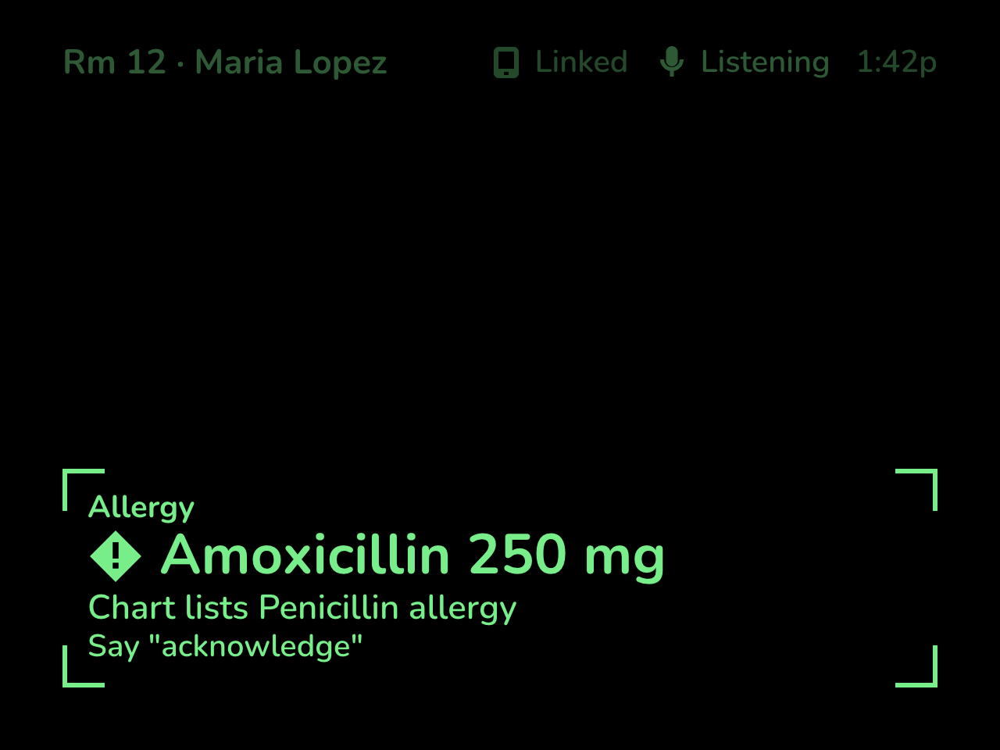 | 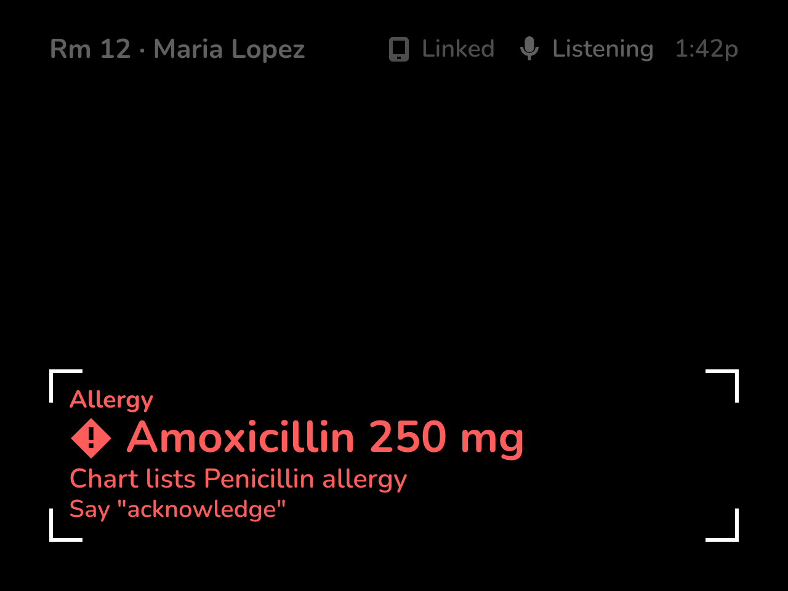 |

Caveat: the alert compares the chart's own allergy list and drug class tags in synthetic data. It is not a clinical decision support engine and it never blocks the nurse.

### 2. The dead-zone dose: zero loss, recovery measured on /stage

The nurse walks into an elevator and the link drops. She says "done"; the glasses show `Queued · offline` and keep the action in a local outbox. When the link returns the outbox flushes in order, first-write-wins applies, and the med is given exactly once. The `/stage` projector page shows the link down with a timer, then the replay: how many actions were replayed, how long they queued, and `0 lost` only when every device reports the same state version.

| Linked | Link down | Recovered |
|---|---|---|
| 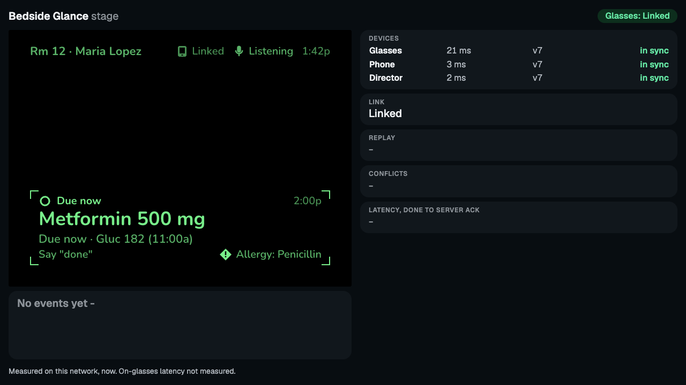 | 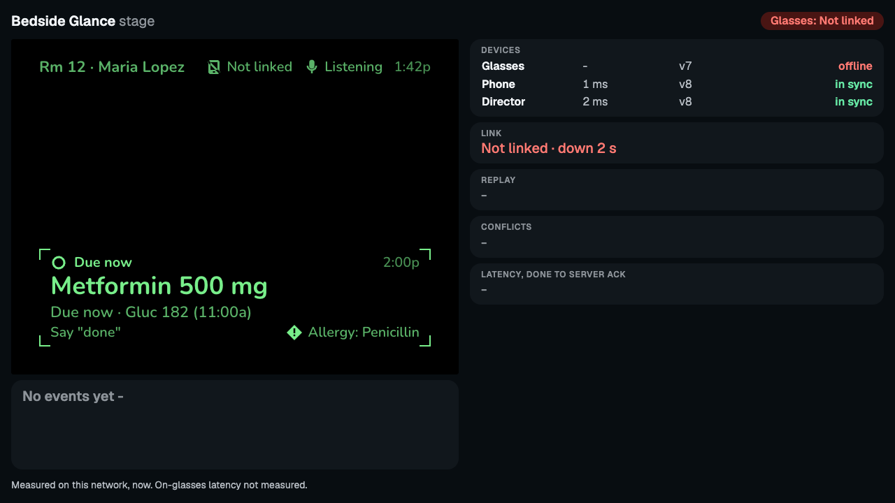 | 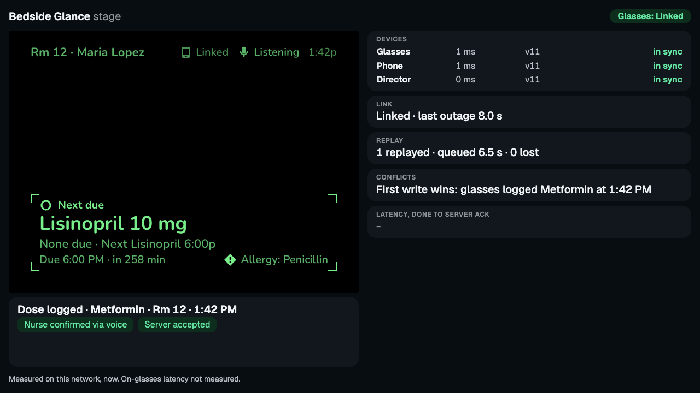 |

Caveat: these numbers are measured on this network, now, as server-side timing between a laptop and local devices. On-glasses latency is not measured, and the rail shows `-` for anything unmeasured.

### 3. The shift-change handoff: read-back, then accept

Priya says "hand off". Marcus's phone shows an I-PASS style sheet built from the shift log by fixed rules (no model). Every critical item (allergies and doses given in the last 4 hours) needs a **Read back** tap on Marcus's device, and **Accept handoff** stays locked until none are left. The offering device cannot accept its own handoff. Afterwards, when Marcus taps the dose Priya already gave, he sees `Already given {time} via glasses`: first write wins.

| Handoff sheet (Accept handoff visible) | Already given via glasses |
|---|---|
| 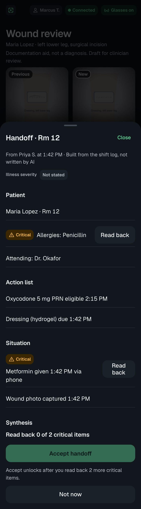 | 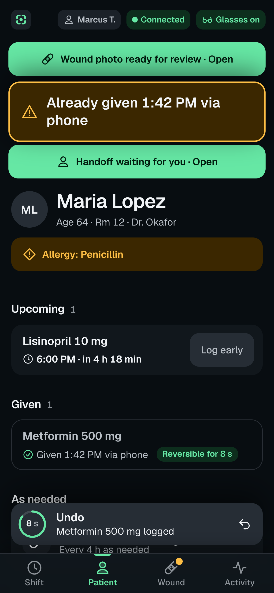 |

Caveat: published I-PASS results are from physician residents, and we make no claim that they transfer to nurses or that this reduces errors. Illness severity is `Not stated` unless the nurse picks it; it is never computed.

## Product

### The problem

Sourced figures (read 2026-11-21; several are secondary summaries, so treat them as published estimates):

- Medication passes are interrupted constantly: 53.1% of 4,271 observed administrations were interrupted, and each interruption was linked to a 12.1% rise in procedural failures and a 12.7% rise in clinical errors (Westbrook et al., Archives of Internal Medicine, 2010).
- Observed medication-administration error: roughly one in five observed doses in direct-observation studies, mostly timing errors (Keers et al. 2013, Ann Pharmacother 47(2):237-256, via secondary summaries such as AHRQ PSNet). The specific figures sometimes quoted (19.6% and 8.0%) could not be verified at the primary source, so we do not use them.
- Barcode scanning is bypassed: the abstract reports workarounds in 66% of administrations (its results table gives 3,633 of 5,793, about 63%), and 36% of the workarounds were procedural, such as not scanning at all (van der Veen et al., J Am Med Inform Assoc 2018;25(4):385-392, PMC7646849).
- Charting competes with patients: 79% of acute-care nurses report losing time each week to charting they call unproductive (KLAS/Arch, 2025, n=80,147; self-reported).
- Losing a bedside nurse costs about $60,090 (NSI National Health Care Retention Report, 2026).

Earlier headset programs (Google Glass Enterprise, HoloLens 2) ended on price, lock-in and no workflow integration. Bedside Glance targets a low-cost display and a phone-first path. Source table: [docs/PITCH.md](docs/PITCH.md), [docs/STORY-RESEARCH.md](docs/STORY-RESEARCH.md).

### What it does

A fictional nurse, Priya, on a synthetic med-surg ward:

1. Looks at a wristband. The glasses read it (center of view only) and show the meds card: allergy, drug due now, latest glucose.
2. Says "done" or taps. The dose is logged and the phone shows `{time} · via glasses`.
3. If the phone logged the same dose first, the glasses show `Already given {time} via phone`. First write wins; undo works from either device for 10 seconds.
4. Says "my leg hurts" or "wound": a PRN card or the wound flow appears only if the chart supports it.
5. Captures a wound photo. The phone shows a side-by-side and a draft note for clinician review (model-drafted only if `GEMINI_API_KEY` is set; otherwise a fixed sample labelled "Sample result"). "Send to Dr. Okafor" lands back on the glasses.
6. Loses Wi-Fi: actions queue (`Queued · offline`) and reconcile on reconnect.
7. Hands the patient to the next nurse with a read-back handoff.

### Glasses HUD

| Idle | Scanning | Meds card | Logged |
|---|---|---|---|
| 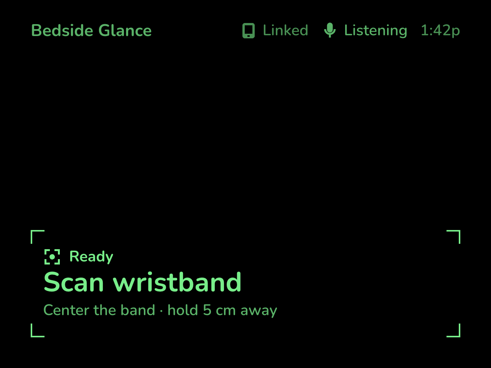 | 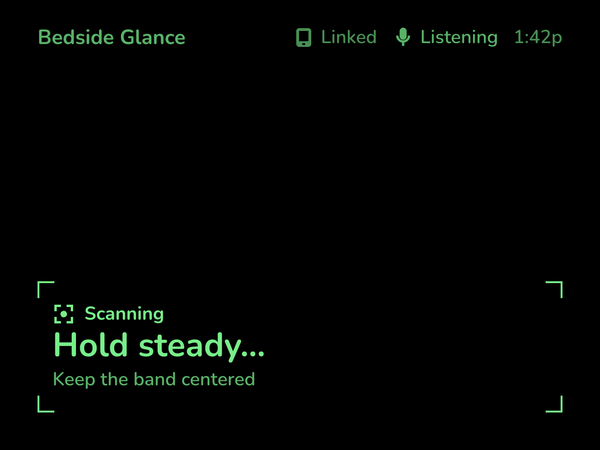 | 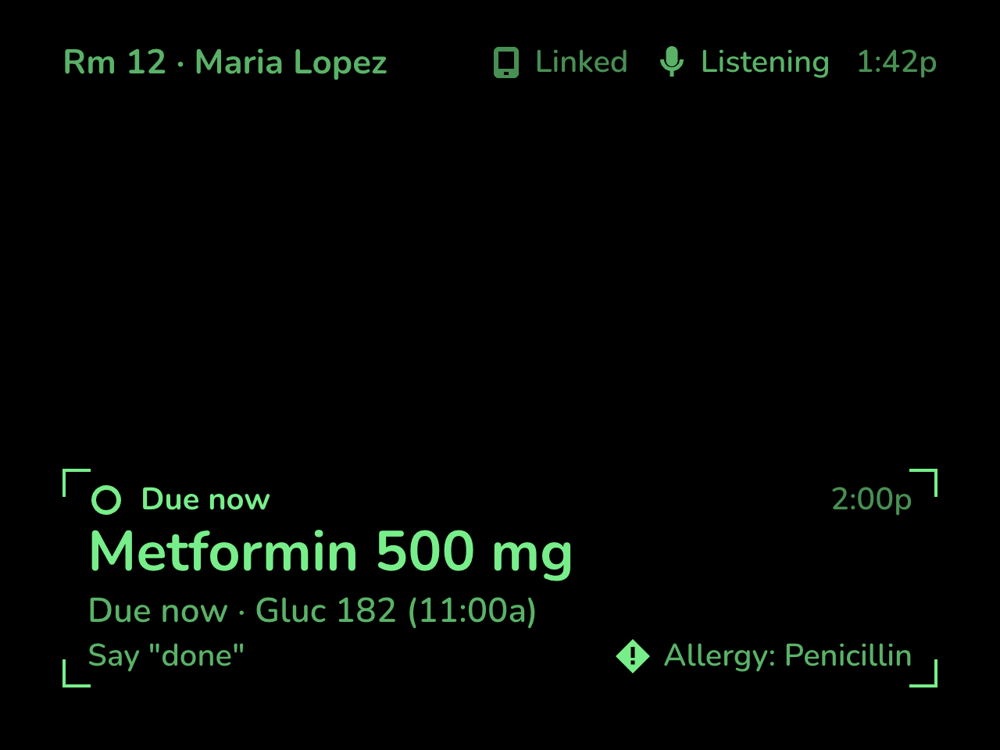 | 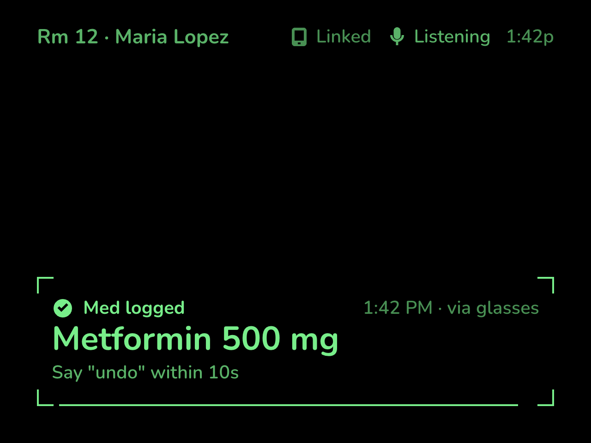 |

| PRN available | Wound prompt with dressing | Wound draft | First-write-wins conflict |
|---|---|---|---|
| 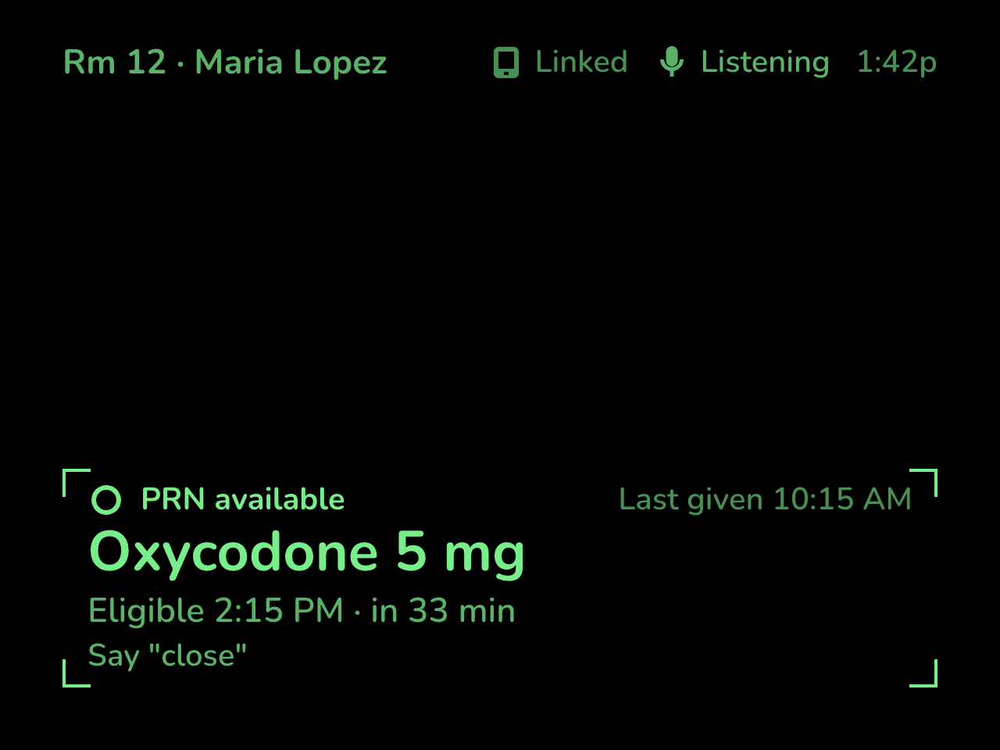 | 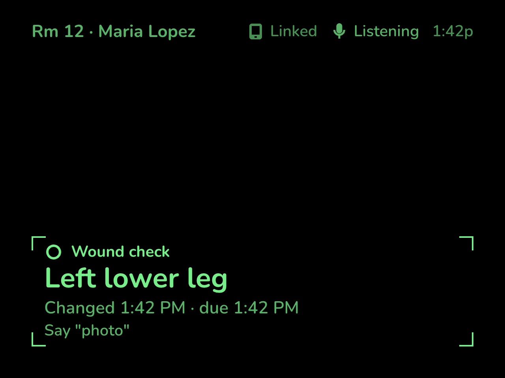 |  | 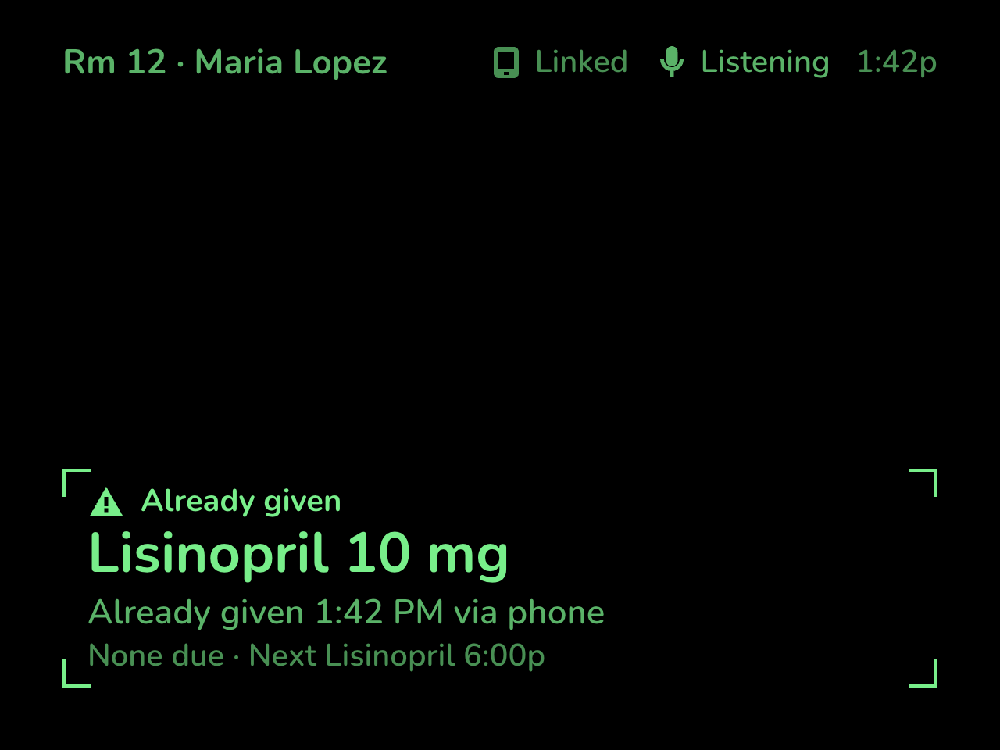 |

**The display law.** The M6 is a 640x480 see-through waveguide: black pixels are transparent, so anything drawn in the middle sits over the real room and the patient.

- Black background; the clear zone (x120-520, y90-290) is always empty.
- One card in the bottom band (y300-440), 528 px of inner width, at most 4 lines and one hero value.
- Text 18 px or larger (shipped roles: 20, 22 and 36 px), bright and heavy, every line single-line with ellipsis. A test measures every string with the real font file so nothing overflows.
- Meaning never relies on color alone (filled icons plus words). Nothing flashes; nothing pulses above 1 Hz.
- Auto-fade is deliberate: the meds card and wound assessment never fade while a patient is loaded; a critical allergy never fades until the nurse says "acknowledge".
- Copy is locked verbatim to the FRD and audited by a golden test.

Rules and sources: [docs/UX-RULES.md](docs/UX-RULES.md), [docs/DESIGN-SYSTEM.md](docs/DESIGN-SYSTEM.md), [docs/FRD-v2.2.md](docs/FRD-v2.2.md) sections 1 and 2.

### Phone UI

| My shift | Patient | Wound review | Activity feed |
|---|---|---|---|
| 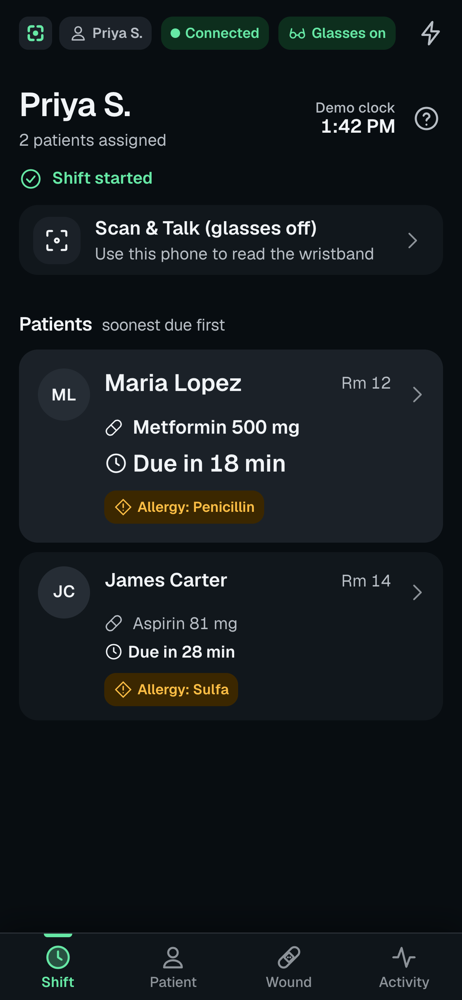 |  | 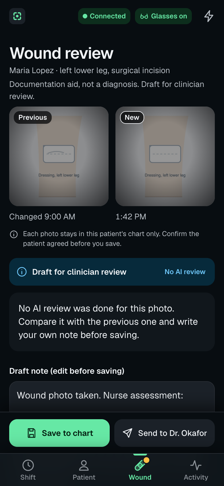 | 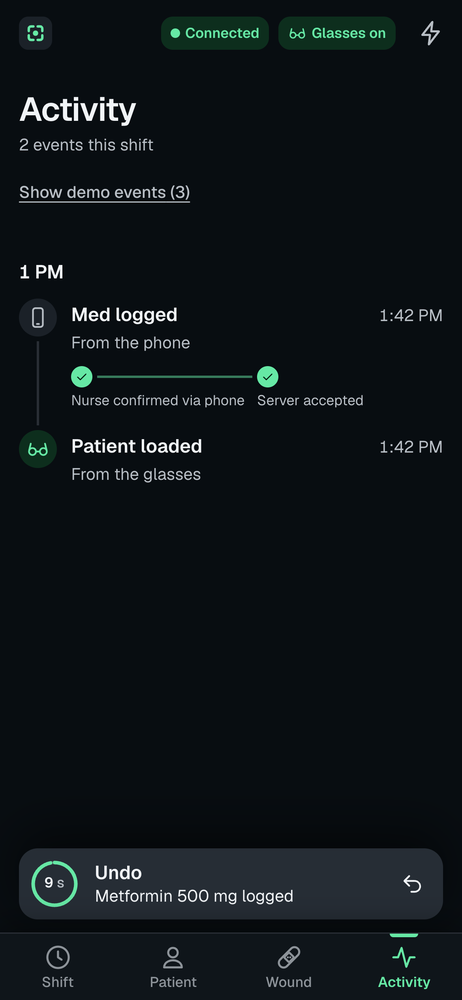 |

The phone is the depth surface: chart, early-dose and allergy confirm dialogs, wound review, an activity feed where every event carries a verification chain (for example Wristband matched, Nurse confirmed via voice, Server accepted), and the handoff sheet. A Director drawer (`/phone?director=1`) drives every scenario and has a hold-to-confirm reset.

### Nurse-entered dressing documentation

The wound card on the phone has a Dressing section: the nurse picks a type from a list, when it was last changed, and an interval she chooses (24, 48 or 72 hours, or "per protocol"). The server only adds the interval to the time she gave. It never chooses an interval, reads anything from the dressing, or recommends one. The documented dressing is shown on the phone, appended to the saved note as `Dressing (documented by nurse): ...`, and appears on the glasses wound prompt as `Changed {time} · due {time}`. The glasses never offer a dressing action.

| Glasses wound prompt | Phone Dressing card |
|---|---|
|  | 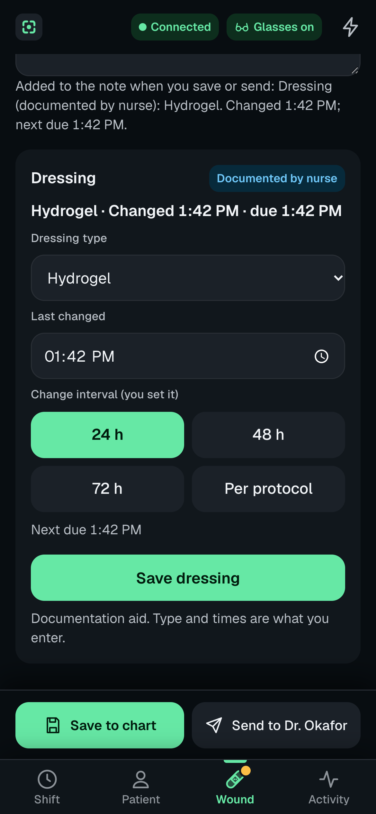 |

Background and what we will not claim: [docs/HYDROGEL-RESEARCH.md](docs/HYDROGEL-RESEARCH.md).

### Impact calculator

`/impact` is an interactive business-case page with every assumption editable (nurses per unit, minutes saved per shift, capture rate, device price, running cost). Its formulas live in `src/apps/bedside-glance/impact/calculator.ts`, and a test (`docs-numbers.test.ts`) fails if the README, pitch or deck quote a number the calculator does not produce.

| Desktop | Phone |
|---|---|
| 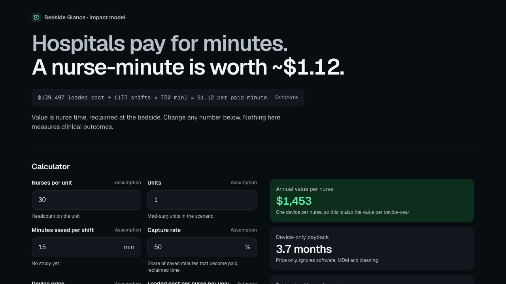 | 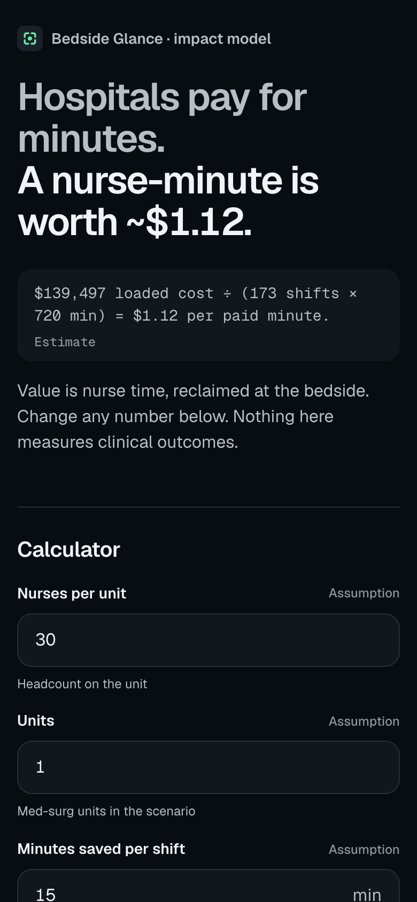 |

## Engineering

One Vite + React + TypeScript SPA and one Node/Express/`ws` server. `shared/` (types, demo clock, allergy check, I-PASS builder, sync-health math) is imported by both. No database, no cloud storage, no CSS framework on the glasses page.

### Architecture

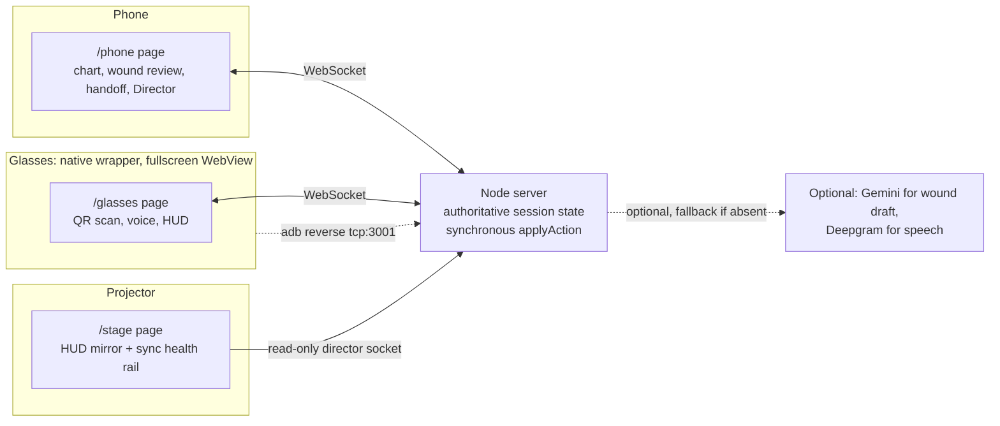

The glasses run Android 9 with plain Android APIs and no glasses-side SDK, so the HUD is a web page in a fullscreen WebView wrapper reaching the server over USB (`adb reverse`) or an https URL. The phone SDK path (BLE) is out of scope; sync is a small WebSocket message over Wi-Fi. Decision record: [docs/decisions/topology.md](docs/decisions/topology.md).

### Sync-correctness invariants and how each is tested

| Invariant | Mechanism | Evidence |
|---|---|---|
| One writer wins a dose | `applyAction` has no awaits, so on single-threaded Node first-write-wins cannot race | `server/stress.abuse.test.ts`: 200 sockets in one session, exactly one winner |
| Replays are harmless | Every action has a `clientEventId`; a seen id returns the original result (cache keyed per device) | `server/stress.fuzz.test.ts`: a duplicate id never changes state |
| Undo is bounded | `UNDO_LAST_MED` works within 10,000 ms of the server's accept time, from either device | fuzz invariant; mutation check with the window widened by 1 ms failed |
| Offline loses nothing | Client outbox in `localStorage`, flushed in order on reconnect, server results adopted | `server/offlineFlush.test.ts`, soak run, `/stage` replay line |
| Devices converge | Peers report their state version in pings; the server computes `converged`, `behind` or `idle` | `shared/stats.test.ts`, `server/stats.ws.test.ts`, soak convergence check |
| Identity comes from the socket | `device` and `instance` are derived server side; a body field is dropped | `server/hardening.test.ts`, `server/handoff.ws.test.ts` |
| Director power is gated | `RESET_SESSION`, clock and every `SIM_*` need director capability (and `DIRECTOR_KEY` if set) | `server/hardening.test.ts` |
| Reset is complete | `RESET_SESSION` clears every section the FRD lists and keeps the event cursor monotonic | fuzz invariant |
| Events run once | Each event has a monotonic `seq`; clients keep a cursor, a fresh page replays nothing | `server/offlineFlush.test.ts` |

### Protocol and handoff design

Full contract: [docs/FRD-v2.2.md](docs/FRD-v2.2.md) section 4. The pieces that matter:

- **Acknowledgements for every action.** The server answers the sender with a result (ok, conflict or failure) so the UI can toast `Already given ...` or `Too late to undo` live.
- **Sync health.** Pings carry a sequence number, the client's state version, outbox depth and last round trip. The server sends `stats` frames only to director sockets, at most 2 per second. That is what powers the `/stage` rail, and unmeasured values stay `-`.
- **Chaos on purpose.** `SIM_CHAOS_DROP` makes the glasses go offline for 3 to 15 seconds from their own timers (no server timer), optionally log a dose while offline, then come back.
- **Allergy protocol.** `ALLERGY_ACK` records that the alert was seen (idempotent, capped). It is not consent: `LOG_MED` on a conflicting drug is refused with `Chart lists {allergy} allergy` unless the phone sends an explicit override flag. On the glasses an acknowledged conflicting order sorts last, so "done" logs the next real med.
- **Handoff.** `buildHandoff` is a pure function that turns the shift log into I, P, A and S items and marks critical ones. The packet moves through two server-checked steps, with per-item read-back required before accept.

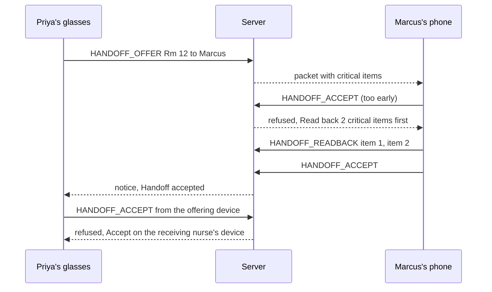

The invariant, fuzzed in `server/handoff.test.ts`: accepted implies every critical item was read back and the accepting browser instance differs from the offering one. A missing instance fails closed.

### Legacy WebView and budgets

The glasses page targets Chromium around 69 (factory WebView version unknown). Details and measurements: [docs/COMPAT-PERF.md](docs/COMPAT-PERF.md).

- Vite builds for `chrome69` (its default would leave `?.` and `??` in the output). `npm run check-legacy` parses every built chunk and scans CSS and source for features that do not exist on 69 (flex `gap`, `inset`, `clamp()`, `dvh`, and others).
- Hand-written polyfills install only when the native API is missing.
- Phone, impact and QR routes are lazy chunks; `npm run check-budgets` proves `/glasses` does not load them.
- `/glasses` budget: 140,000 B JS and 2,010 B CSS gzip; measured 125,947 B and 1,828 B (2026-11-21).
- QR decode of a 480x480 frame: median 0.36 ms, p95 0.46 ms in Node on an Apple Silicon Mac (budget 250 ms at 4 FPS). The device may be far slower; this is not a proxy.

### Test strategy

| Layer | What it covers |
|---|---|
| Unit and integration | Reducer, validation, allergy and handoff builders, voice triggers, copy audit, font-measured overflow test, HUD boundary |
| Fuzz | 20,000 seeded action sequences (plus 20 of 1,500 steps) with invariants checked after every step; the seed is in every failure message |
| Abuse | Oversized, nested, binary and numeric-edge frames, 1,000 reconnects, 200-way race, session flood |
| Soak | `npm run stress`: 50 sessions x 20 flows against a real server with socket kills, offline toggles, garbage frames and duplicate events |
| Mutation checks | Deliberately breaking a rule (undo window +1 ms, first-write-wins off, reset leaving data behind, dropping 3% of broadcasts) must fail the suite; each did |
| Browser E2E | `npm run e2e` drives real headless Chrome against the production build, including the stage flow |
| Guard suite | `npm run guard` plus negative tests that plant a violation and prove the guard fails |
| Coverage thresholds | Global 89 / 82 / 84 / 92 (statements, branches, functions, lines), higher for `server/`, `shared/` and `src/hud-kit/` |

### Design decisions and trade-offs

- **Server authority over CRDTs.** One in-memory state machine is simpler to reason about and test than merging; the cost is no horizontal scale and state lost on restart.
- **Deterministic handoff, no model.** A summary a nurse reads back must be reproducible. The cost is less fluent text.
- **Phone-first fallback.** The glasses may be display-only, so the phone scans and listens and the glasses mirror the HUD. This is a supported mode.
- **Hand-written polyfills over core-js.** Smaller bundle on a constrained page; the cost is that we maintain six small shims.
- **Local guards over required CI.** Checks run on teammates' laptops before every push; GitHub Actions is an optional template. The cost is trust that the hook is installed, which `npm ci` and `npm run health` verify.

### Performance, measured

All 2026-11-21, MacBook, Node 26, localhost, real server (details in [docs/COMPAT-PERF.md](docs/COMPAT-PERF.md)):

| Measure | Value | Method |
|---|---|---|
| Soak ack latency | p50 0.43 ms, p95 7.39 ms, p99 113 ms; 10,000 of 10,000 acked | `npm run stress`, 59 s, about 2,000 socket kills |
| Sustained | 32,970 of 32,970 acked (536/s), p95 2.86 ms | `npm run stress -- --duration 60 --pause 150` |
| Convergence | All three clients equal the server after each session | soak harness |
| Memory | RSS plateaus; heap after GC grows under 2 MB | same runs |

## Teammate workflow

Design: teammates push to main with local guards doing the checking ([docs/GUARDRAILS.md](docs/GUARDRAILS.md)).

```
npm ci                # installs dependencies and the pre-push hook
npm run health        # PASS / WARN / FAIL list with a fix per line
npm run ship -- "what you changed"
npm run rollback      # restore the last-known-good version as a new commit
```

- `npm run ship` runs the full check, smoke test and e2e, rebases on the latest, pushes, then moves the `last-known-good` tag. It refuses after the freeze: **Sat 2026-11-21, 2:00 PM ET**.
- `npm run rollback` saves your state on a backup branch first, then makes the files identical to `last-known-good`.
- The pre-push hook runs `npm run check`, so a failing push is blocked locally. Never use `--no-verify` or force-push.
- **What the guards block:** secrets and key shapes, forbidden tracked files, the banned model id, Windows-unsafe scripts, weakened tests (added skips, lowered thresholds, removed assertions), hidden Unicode characters, unapproved dependencies and new network hosts, instruction-style text in docs, and leaks of confidential vendor material.

**Quick start** (Node 22.12+; everything runs without an API key):

```
git clone https://github.com/RahulModugula/worn-hackathon.git
cd worn-hackathon
npm ci
npm run doctor
npm run build && npm start     # one port, 3001
```

| What | Path |
|---|---|
| Glasses HUD (laptop preview) | `/glasses` |
| Phone app | `/phone`, and `/phone?director=1` for Director controls |
| Second nurse (handoff receiver) | `/phone?nurse=N-02` |
| Stage projector | `/stage` (fallback: `/glasses?mirror=1`) |
| Business case | `/impact` |
| Printable wristband codes | `/qr` |

Two-minute demo with no hardware: open `/glasses` and `/phone?director=1`, tap Start shift, open the Director drawer, "Sim Scan Rm 12", then "Voice: Done". "RESET DEMO" restores the starting state.

- **Mac:** `brew install node`, then the commands above.
- **Windows:** `winget install OpenJS.NodeJS.LTS`, reopen PowerShell, clone into a plain folder such as `C:\dev` (not OneDrive). All npm scripts are plain Node. If scripts are blocked, run `Set-ExecutionPolicy -Scope CurrentUser RemoteSigned`. Allow node.exe on Private networks the first time.
- **iPhone:** join the laptop's Wi-Fi and open the printed `http://192.168.x.x:3001/phone`. Camera and microphone need https, so for scanning use a deployed https URL (`render.yaml` is included). Set `DIRECTOR_KEY` on any public deploy.
- **M6 glasses:** enable developer mode, check `adb devices`, keep the server running, then `npm run m6:install`. Runbook: [docs/decisions/kill-gate-runbook.md](docs/decisions/kill-gate-runbook.md); full walkthrough: [docs/TEAMMATE-GUIDE.md](docs/TEAMMATE-GUIDE.md).
- **No keys:** `GEMINI_API_KEY` and `DEEPGRAM_API_KEY` are optional (names only; see `.env.example`). Without them speech falls back to the browser recognizer, then tap and Director buttons, and the wound result is a labelled sample.

## Business and go-to-market

Full write-up with evidence tags: [docs/GTM-BUSINESS.md](docs/GTM-BUSINESS.md). Pitch and sourced numbers: [docs/PITCH.md](docs/PITCH.md).

- **Who pays:** hospital health systems, from the nursing and quality budget. The buyer is the nurse manager or CNO; the first unit is med-surg.
- **Value (our arithmetic):** a bedside RN costs about $139K a year loaded (BLS median RN wage of $97,550, May 2025, all industries, x 1.43, our assumed benefits multiplier), so one minute per shift is worth about $194 a year per nurse, or $1.12 per minute of shift time. Market context: 3,465,400 RN jobs in the US in 2025, about 59% in hospitals (BLS Occupational Outlook Handbook, read 2026-11-21).
- **Break-even (from the calculator):** at 50% of saved time captured as real capacity, a roughly $450 device breaks even at about 4.6 minutes saved per shift (`breakEvenMinutesPerShift` in `src/apps/bedside-glance/impact/calculator.ts`: 450 / (173 shifts x $1.12 per minute x 0.5)). At 15 minutes the same inputs give about 3.7 months (4.1 months with a $120 a year running cost). Payback here means device price only, one device per nurse, and excludes servers, support, training, wristbands and integration.
- **Assumptions, labelled:** the 15 minutes per shift, the 50% capture, the 1.43 multiplier and the $450 device price are our assumptions. No study measures glasses savings. The pilot's job is to measure it.
- **Pilot design (proposal):** one adult med-surg unit with a matched control, 10-12 devices, a 2-week baseline then 12 weeks of use. Primary metric: medication interruptions per pass by direct observation. Secondary: scan compliance, documentation minutes, near-misses, usability, uptime. Stop rules for any safety event or security finding. See [docs/RESEARCH-INSTITUTIONS.md](docs/RESEARCH-INSTITUTIONS.md) section 6 and [docs/GTM-BUSINESS.md](docs/GTM-BUSINESS.md) section 4.
- **Why a glasses maker should care:** a hospital says yes at roughly the $300-600 price point (our target ask, not a quote), a first clinical reference needs a measured pilot, and the phone-first design means the glasses are a thin, replaceable display. The honest risk the research flags is vendor longevity; Google Glass Enterprise and HoloLens 2 both ended.
- **Sensitivity:** below about 6 minutes saved per shift at 50% capture, a $25 per seat per month software price fails the hospital's own test ([docs/GTM-BUSINESS.md](docs/GTM-BUSINESS.md) section 2.3).

## Clinical and institutional context

- Nurse workflow evidence, handoff and BCMA findings, and the feature-to-pain mapping: [docs/RESEARCH-NURSES.md](docs/RESEARCH-NURSES.md).
- How hospitals buy, security gates, existing deployments, the top objections and a pilot design: [docs/RESEARCH-INSTITUTIONS.md](docs/RESEARCH-INSTITUTIONS.md).
- Hydrogel dressings and what we will not claim: [docs/HYDROGEL-RESEARCH.md](docs/HYDROGEL-RESEARCH.md).
- **Key findings:** barcode workarounds and interruptions are common; handoff is a known risk point; phone-based scanning already exists, so glasses must win where hands are busy or gloved; earlier headsets died on price and integration.
- **Regulatory note:** this is a documentation and verification aid. The nurse decides. A wound photo is a medical image, and FDA's January 2026 clinical decision support guidance keeps software that analyzes a medical image outside the non-device exemption, so the wound feature drafts a note for clinician review and does not measure, stage or diagnose. This is an unregulated hackathon prototype on synthetic data and **not a medical device**. A real deployment needs a regulatory assessment, a documented intended use, a business associate agreement, encryption, device management, and privacy and infection-prevention sign-off first.

## Measured and unmeasured

Measured on a MacBook, 2026-11-21 (methods in [docs/COMPAT-PERF.md](docs/COMPAT-PERF.md)):

| Measure | Value | Method |
|---|---|---|
| Tests | 826 passed, 73 files (820 passed and 6 skipped before a build) | `npm test` after `npm run build` |
| Coverage (excludes `server/index.ts`, `src/main.tsx`, `src/polyfills.ts`, tests) | statements 91.19%, branches 86.97%, functions 88.15%, lines 94.37% | `npm run coverage` (v8) |
| `/glasses` bundle | 125,947 B JS and 1,828 B CSS gzip (budgets 140,000 / 2,010) | `npm run build`, `npm run check-budgets` |
| QR decode, 480x480 | median 0.36 ms, p95 0.46 ms | `npm run bench`, Node, 200 runs |
| Soak | 10,000 of 10,000 acked; p50 0.43 ms, p95 7.39 ms, p99 113 ms | `npm run stress`, localhost |
| Fuzz | 20,000 seeded sequences | `server/stress.fuzz.test.ts` |
| Browser E2E | 12 of 12 checks | `npm run e2e` |

| Not measured |
|---|
| Everything on the real M6 glasses: scan success, scan-to-card time, "done"-to-phone latency, voice and camera, key events, battery, temple heat, long-wear comfort |
| The Android 9 WebView version and decode speed on that device |
| Live Gemini and Deepgram accuracy and latency, and noisy-ward voice |
| Any clinical or time-saving outcome |
| Chromium 69 behavior beyond static checks |

## Known limitations

- No per-user login: anyone on the session can act as the nurse; Director controls are gated only by an optional `DIRECTOR_KEY`.
- Only the patient is scanned, not the drug: this is not closed-loop barcode medication administration.
- State lives in server memory; a restart resets the ward. Up to 20 wound photos are held in memory.
- No MDM or fleet story; sideload via adb is the only install path.
- No business associate agreement with Deepgram or Gemini; synthetic data only.
- The handoff covers one patient at a time and has no escalation path if the receiving nurse never responds.
- Nothing is verified on real glasses yet: [docs/decisions/kill-gate.md](docs/decisions/kill-gate.md).

## Reviewer FAQ

### Clinical safety

- **Can it give the wrong patient's meds?** The scan needs 3 matching reads within 1.2 s from the center crop; an edge-of-view band never decodes (tested). A band for a patient not on the nurse's list shows `Not on your list` and never loads. The nurse still confirms every dose.
- **What if two people log the same dose?** The server accepts the first and refuses the second with `Already given {time} via {device}`. Undo works for 10 s from either device.
- **Does the allergy alert block anything?** The alert itself does not. The server does refuse logging an allergy-conflicting drug unless the phone sends an explicit confirmation, and "acknowledge" is never treated as consent.
- **Is the wound analysis diagnostic?** No. It is a draft for clinician review, labelled as such.
- **Does it recommend dressing changes?** No. The interval is picked by the nurse; the server only adds it to the time she entered.
- **Is it all five rights?** No. It verifies patient, surfaces allergy and due time, and records the dose.

### Handoff

- **What is in the handoff?** Illness severity (only if the nurse states it), patient and allergies, an action list (meds due in the next 4 hours, PRN time, dressing due) and a situation summary from the shift log.
- **Why a read-back?** Critical items must be repeated by the receiver on the receiver's device before Accept unlocks.
- **Can the sender accept their own handoff?** No. The server refuses accept from the offering browser instance.
- **Is the summary AI-written?** No. It is built by fixed rules from the shift log, so it is reproducible and testable.
- **Is there evidence it works?** No. I-PASS evidence comes from physician residents. We make no outcome claim.
- **What if the offer is sent twice?** A second offer for the same patient and nurse returns `Handoff already offered`.

### Business

- **Who pays and what is the saving?** Health systems. The 15 min/shift saving is our assumption, not a measurement.
- **Why glasses and not a phone?** The phone is the depth surface here. Glasses win where hands are busy or gloved: identity, allergy and drug appear in the first second.
- **Why did earlier glasses fail?** Price, lock-in and no workflow integration. We target a low-cost display and a phone-first path.
- **What would prove the idea wrong?** Measured savings under about 5 minutes per shift, nurses not wearing the device, or a capture rate well under 50%.
- **Do you have customers?** No. No pilot, no customer interviews.
- **Is the market size known?** We do not publish one. Analyst figures disagree widely.

### Engineering

- **What is the hard part?** Making devices that can disagree always agree: one synchronous state machine, idempotent ids, an outbox, bounded undo, checked by fuzz, abuse and soak tests that were shown to fail when a rule is broken.
- **Why in-memory server state?** Simplicity and testability for a prototype. A real deployment needs durable storage and an audit log.
- **Does any domain code leak into the HUD kit?** A test enforces that `src/hud-kit/` has no Bedside Glance strings and no imports from `src/apps/`.
- **Is it real or mocked?** Decode, state, sync, logging and handoff are real code paths. Wound text is a fixed sample unless a Gemini key is set, and is labelled either way.
- **How do you know the tests can fail?** Mutation checks and guard negative tests plant a violation and require a failure.
- **Does it run on Windows?** All scripts are plain Node; line endings are forced to LF.

### Guardrails and process

- **How is main kept working?** Local pre-push check, `npm run ship`, a `last-known-good` tag and `npm run rollback`.
- **What stops a teammate weakening a test?** A diff guard fails on added skips, removed assertions, lowered coverage thresholds and raised bundle budgets.
- **What about secrets?** Key shapes and `VITE_*` secret names fail the guard; keys are environment variables only.
- **What happens at the deadline?** `ship` refuses after 2026-11-21 2:00 PM ET.
- **Is CI required?** No. A GitHub Actions template is provided and optional; see [docs/GUARDRAILS.md](docs/GUARDRAILS.md) for what is unverified.
- **Are docs checked?** Yes: `npm run check-docs` fails on dead links and unknown npm scripts, and a test pins quoted business numbers to the calculator.

### Glasses

- **Does it run on the M6?** The architecture targets it and the build is lowered to Chromium 69 with static guards, but on-glasses behavior is not verified.
- **What if the camera, mic or buttons are unavailable?** The phone scans and listens and the glasses mirror the HUD. This is a supported mode.
- **Battery and heat?** Not measured. The scanner runs at 4 FPS and only on idle and scan screens, a design choice, not a result.
- **Is text readable on the waveguide?** The 18 px floor and luminance ladder come from published guidance and are unmeasured on glass.
- **How is it installed?** Sideloaded via adb with a prebuilt wrapper APK.
- **How are the glasses and phone linked?** Over the server on Wi-Fi or USB reverse, not BLE.

### AI and ML

- **Where is AI used?** Optionally for the wound draft (Gemini) and speech (Deepgram). Nothing else.
- **What about voice commands?** Deterministic keyword matching, tested on a 300+ phrase corpus with zero false positives for done, undo and acknowledge.
- **What happens with no key or network?** Browser speech, tap and Director controls, a labelled sample wound result, and a 4 s cap on waiting for an assessment.
- **Does a model grade its own work?** No. Identity is an exact payload match and medication state is a deterministic state machine.
- **How is model output labelled?** "AI result" when it came from the model, "Sample result" or "Photo only" otherwise, always as a draft for clinician review.

### Privacy

- **Is any real data used?** No. All data is synthetic, enforced by `npm run audit-pii`.
- **Is audio or video stored?** No. Wound photos are held in server memory only (up to 20) and lost on restart.
- **What leaves the device?** Audio goes to Deepgram only if a key is set; wound photos go to Gemini only if a key is set. There is no BAA with either, so synthetic data only.
- **HIPAA?** Not assessed. A deployment needs a BAA, encryption in transit and at rest, device management and sign-off.
- **Who can reset or simulate?** Only Director connections, plus a matching key when `DIRECTOR_KEY` is set.

## Docs index

- [docs/FRD-v2.2.md](docs/FRD-v2.2.md): source-of-truth spec, protocol and 14 acceptance criteria
- [docs/DESIGN-SYSTEM.md](docs/DESIGN-SYSTEM.md), [docs/UX-RULES.md](docs/UX-RULES.md): visual and interaction rules
- [docs/COMPAT-PERF.md](docs/COMPAT-PERF.md): Chromium 69 guards, budgets, benchmarks, stress results
- [docs/GUARDRAILS.md](docs/GUARDRAILS.md): the guard layers, rollback and freeze
- [docs/PITCH.md](docs/PITCH.md), [docs/STORY-RESEARCH.md](docs/STORY-RESEARCH.md): sourced numbers and positioning
- [docs/GTM-BUSINESS.md](docs/GTM-BUSINESS.md): business model, pilot, risks
- [docs/RESEARCH-INSTITUTIONS.md](docs/RESEARCH-INSTITUTIONS.md), [docs/RESEARCH-NURSES.md](docs/RESEARCH-NURSES.md), [docs/HYDROGEL-RESEARCH.md](docs/HYDROGEL-RESEARCH.md): research notes
- [docs/demo-script.md](docs/demo-script.md): the 3:00 stage arc and 90 s table cut
- [docs/TEAMMATE-GUIDE.md](docs/TEAMMATE-GUIDE.md): setup, glasses install, fallbacks, deploy
- [docs/GALLERY.md](docs/GALLERY.md): every screenshot; [docs/img/demo.gif](docs/img/demo.gif): demo loop
- [docs/decisions/](docs/decisions/): topology, kill-gate and acceptance sweep records; [docs/decks/](docs/decks/): pitch decks

## Repo map

| Path | Contents |
|---|---|
| `src/hud-kit/` | Generic glasses HUD toolkit: tokens, components, QR scanner, voice engine (no domain strings) |
| `src/apps/bedside-glance/` | The app: glasses, phone, stage and impact screens, store, voice triggers |
| `src/pages/` | Route pages |
| `server/` | Express + `ws` server, authoritative `applyAction`, wound assessment, tests |
| `shared/` | Types, demo clock, allergy check, handoff builder, sync-health math |
| `data/` | Synthetic patients and fallback responses |
| `android-wrapper/` | Native fullscreen WebView wrapper for the glasses |
| `scripts/` | doctor, health, ship, rollback, guards, budgets, screenshots, E2E, stress, M6 helpers |
| `docs/` | Spec, design, research, pitch, decisions, decks, screenshots |

## Verify

```
npm run check       # typecheck, HUD boundary, PII audit, docs, guards, build, legacy check, budgets, tests
npm test            # unit, integration, fuzz and abuse tests
npm run coverage    # coverage with thresholds
npm run guard       # guards, docs check and guard tests
npm run e2e         # headless-browser end-to-end checks
npm run stress      # soak and chaos harness against a real server
npm run screenshots # regenerate docs/img from the real build
```

## License and credits

No open-source license has been chosen yet; all rights are reserved by the authors pending that decision. Third-party packages keep their own licenses (see `package.json`); fonts are Nunito and Geist via Fontsource. The MicroLumin M6 SDK kit is confidential, is not part of this repository and is not redistributed here; public facts used in these docs are the 640x480 display and Android 9. Nurse, patients and physician in the demo are fictional.
