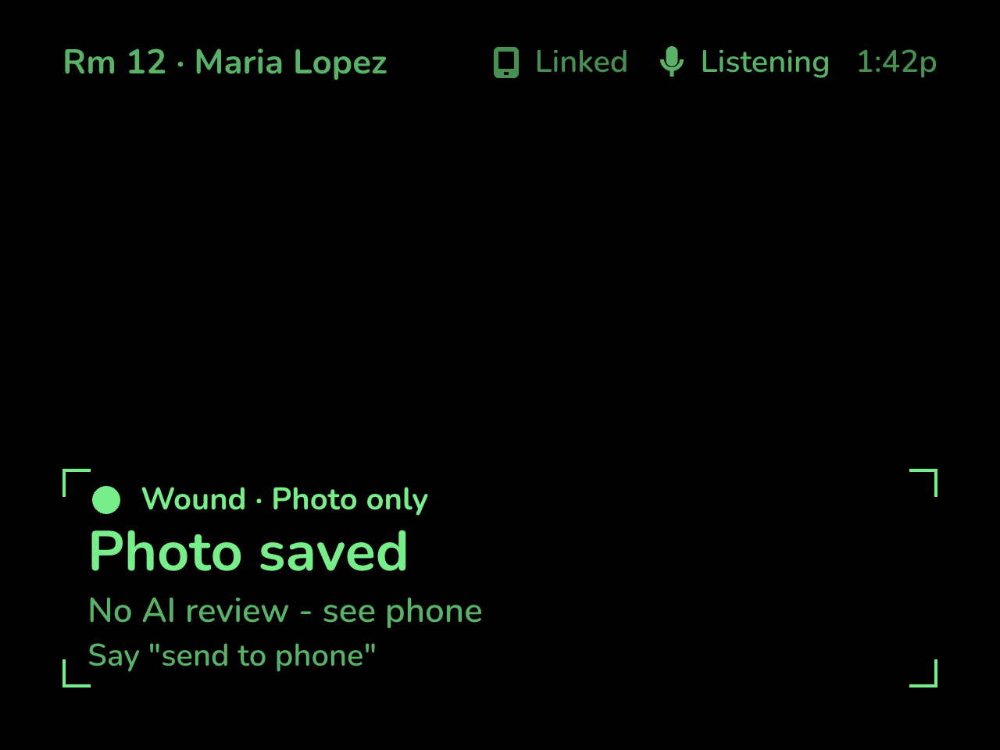
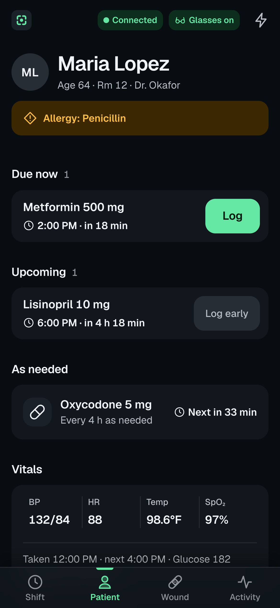
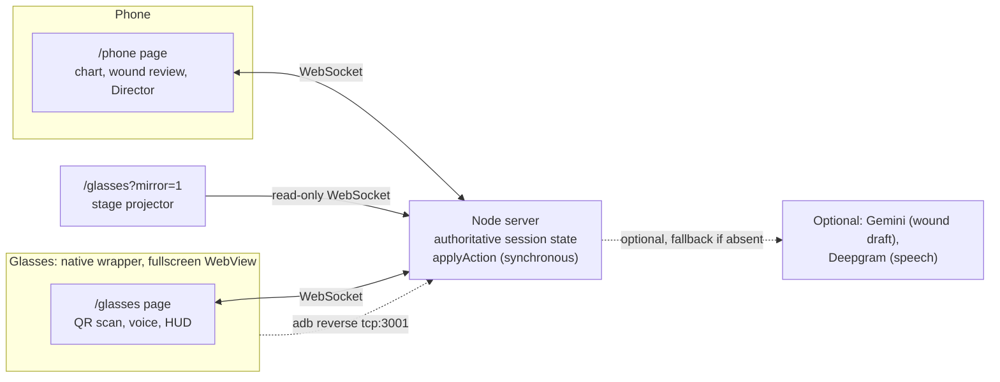
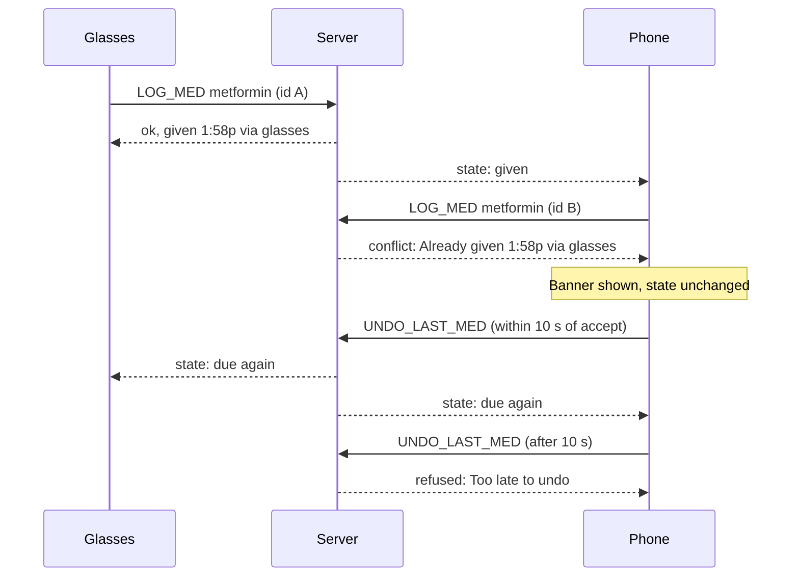

<div align="center">


# Bedside Glance

**The right patient, the right drug and the allergy warning in a nurse's line of sight, hands free, charted to the phone in one tap or word.**

Status: working prototype, built Nov 20-21, 2026 | Tests: 567 passing (50 files) | Real M6 glasses: not yet verified | Data: synthetic only | Not a medical device

</div>

Glance on the glasses, depth on the phone. Built for the Worn Smart Glasses Hackathon (track: Seamless Handoff) for the MicroLumin M6 glasses (640x480 see-through display, Android 9) plus a phone.

## The problem

Sourced figures (read 2026-11-21; several are secondary summaries, so treat them as published estimates):

- Medication passes are interrupted constantly: 53.1% of 4,271 observed administrations were interrupted, and each interruption was linked to a 12.1% rise in procedural failures and a 12.7% rise in clinical errors (Westbrook et al., Archives of Internal Medicine, 2010).
- Observed medication-administration error: median 19.6% of opportunities for error across 91 direct-observation studies when wrong-time errors are counted, 8.0% when they are excluded (Keers et al. 2013, Ann Pharmacother, abstract read 2026-11-21 via Europe PMC; the denominator is opportunities for error, not only doses, and timing errors are a large share).
- Barcode scanning is bypassed: workarounds in 66% of administrations, scanning skipped in 36% (multicenter study of barcode-medication-administration hospitals).
- Charting competes with patients: 79% of acute-care nurses report losing time each week to charting they call unproductive (KLAS/Arch, 2025, n=80,147; self-reported survey).
- Losing a bedside nurse costs about $60,090 (NSI National Health Care Retention Report, 2026).

Earlier headset programs (Google Glass Enterprise, HoloLens 2) ended on price, lock-in and no workflow integration. Bedside Glance targets a low-cost display and a phone-first path. Full source table: [docs/PITCH.md](docs/PITCH.md), [docs/STORY-RESEARCH.md](docs/STORY-RESEARCH.md).

## What it does

A fictional nurse, Priya, in a synthetic med-surg ward:

1. Looks at a wristband. The glasses read it (center of view only) and show the patient's meds card: allergy, drug due now, latest glucose.
2. Says "done" (or taps). The dose is logged and the phone shows `{time} · via glasses`. Target is under a second; measured only as the server acknowledgement on localhost (see Measured and unmeasured); glasses-to-phone latency on real hardware is unmeasured.
3. If the phone logged the same dose first, the glasses show `Already given {time} via phone`. First write wins; undo works from either device for 10 seconds.
4. Says "my leg hurts" or "wound": a PRN card or the wound flow appears only if the chart supports it.
5. Captures a wound photo. The phone shows a side-by-side and a draft note for clinician review (AI-drafted only if `GEMINI_API_KEY` is set; without a key the note is a fixed sample, not AI); "send to Dr. Okafor" lands back on the glasses.
6. Loses Wi-Fi: actions queue (`Queued · offline`) and reconcile on reconnect.

| Glasses HUD (640x480) | | | |
|---|---|---|---|
|  |  |  |  |
| Idle | Scanning | Meds card | Critical allergy |
|  |  |  |  |
| Logged | PRN available | Wound draft | First-write-wins conflict |

| Phone (390x844) | | | |
|---|---|---|---|
|  |  |  |  |
| My shift | Patient detail | Wound review | Activity feed |

More captures (color theme, stage mirror, director drawer, wristband print page): [docs/GALLERY.md](docs/GALLERY.md). A demo loop is at [docs/img/demo.gif](docs/img/demo.gif).

## How it works

One Vite + React + TypeScript SPA and one Node/Express/`ws` server. `shared/` types and the demo clock are imported by both. No database, no cloud storage, no CSS framework on the glasses page.



The glasses run Android 9 themselves (plain Android APIs, no glasses-side SDK), so the HUD is a web page in a wrapper app on the glasses reaching the server over USB (`adb reverse`) or an https URL. The phone SDK path (BLE) is out of scope this weekend; sync is a small WebSocket message over Wi-Fi.

Sync is server-authoritative. `applyAction` has no awaits, so on single-threaded Node the first-write-wins rule cannot race. Every action carries a `clientEventId`, so replays are idempotent.



Offline clients keep the last state and an outbox in `localStorage`; on reconnect the outbox flushes in order and the server's first-write-wins results are adopted. Heartbeats and wake events reconnect quickly after an iPhone sleeps. Full contract: [docs/FRD-v2.2.md](docs/FRD-v2.2.md) section 4.

### The display law

The M6 is a 640x480 see-through waveguide: black pixels are transparent, so anything drawn in the middle sits over the real room and the patient. The design follows from that:

- Black background, and the clear zone (x120-520, y90-290) is always empty.
- One card in the bottom band (y300-440), 528 px of usable width, at most 4 lines and one hero value.
- Text 18 px or larger, bright and heavy, every line single-line with ellipsis. A test measures every string with the real font file so nothing overflows.
- Meaning never relies on color alone (filled icons plus words). Nothing flashes; nothing pulses above 1 Hz.
- Auto-fade is deliberate: the meds card and wound assessment never fade while a patient is loaded; a critical allergy never fades until the nurse says "acknowledge".

Rules and sources: [docs/UX-RULES.md](docs/UX-RULES.md), [docs/DESIGN-SYSTEM.md](docs/DESIGN-SYSTEM.md).

## Quick start

Requires Node 22.12+ and git. Everything runs without any API key.

```
git clone https://github.com/RahulModugula/worn-hackathon.git
cd worn-hackathon
npm ci
npm run doctor        # OK / WARN / FAIL with a plain-English fix per line
npm run build && npm start     # production mode, one port (3001)
# or: npm run dev              # Vite on 5173, proxies /api and /ws to 3001
```

The server prints LAN URLs. Open these:

| What | Path |
|---|---|
| Glasses HUD (laptop preview) | `/glasses` |
| Phone app | `/phone` |
| Phone with Director controls (simulate scan, voice, offline, reset) | `/phone?director=1` |
| Read-only stage projection of the HUD | `/glasses?mirror=1` |
| Business case page | `/impact` |
| Printable wristband codes | `/qr` |

Two-minute demo with no hardware: open `/glasses` and `/phone?director=1` side by side, tap Start Shift, open the Director drawer, "Sim Scan Rm 12", then "Voice: Done". "RESET DEMO" restores the starting state.

**Mac:** `brew install node`, then the commands above.
**Windows:** `winget install OpenJS.NodeJS.LTS`, reopen PowerShell, clone into a plain folder such as `C:\dev` (not OneDrive). If scripts are blocked, run `Set-ExecutionPolicy -Scope CurrentUser RemoteSigned` or use `npm.cmd`. Allow node.exe through the firewall on Private networks the first time. All npm scripts are plain Node and run on Windows.
**iPhone:** join the same Wi-Fi as the laptop and open the printed `http://192.168.x.x:3001/phone`. Camera and microphone need https, so for scanning use a deployed https URL (`render.yaml` is included). Set `DIRECTOR_KEY` on any public deploy so reset and simulation actions need a key.
**M6 glasses:** enable developer mode, check `adb devices`, keep the server running, then `npm run m6:install` (forwards port 3001 with `adb reverse tcp:3001 tcp:3001`, installs the wrapper APK, opens `/glasses`). Add `-- --mirror` for projection mode; `npm run m6:logcat` shows key events. Step-by-step: [docs/TEAMMATE-GUIDE.md](docs/TEAMMATE-GUIDE.md); on-glasses test checklist: [docs/decisions/kill-gate-runbook.md](docs/decisions/kill-gate-runbook.md).

**Without API keys** (`GEMINI_API_KEY`, `DEEPGRAM_API_KEY`; names only, see `.env.example`): speech is meant to fall back to the browser recognizer (Web Speech), then tap and Director buttons. Android 9 WebView probably lacks Web Speech recognition: unverified on device; Preflight shows the active tier; the wound assessment shows a fixed result labelled "Sample result" instead of "AI result". **Display-only glasses fallback:** the glasses show `/glasses?mirror=1` while the phone scans (`/phone?scan=1`) and listens.

## Business case

- **Who pays:** hospital health systems, from the nursing and quality budget; buyer is the nurse manager or CNO; first unit is med-surg.
- **Value (our arithmetic):** a bedside RN costs about $143K a year loaded (BLS median hospital RN wage of $100,220 x 1.43, an estimate), so one minute per shift is worth about $199 a year per nurse.
- **Break-even:** at 50% of saved time captured as real capacity, a roughly $450 device breaks even at about 4.5 minutes saved per shift (about 2.3 minutes captured; `breakEvenMinutesPerShift` in `src/apps/bedside-glance/impact/calculator.ts`: 450 / (173 shifts x $1.15 per minute x 0.5) = 4.5). "Payback" here means device price only, per nurse with one device each, within one year; it excludes servers, support, training, wristbands and integration. At 15 minutes the same inputs give about 3.6 months. We assume 15 minutes per shift; no study measures glasses savings, and the pilot's job is to measure it.
- **Ask:** one med-surg unit, 5-10 devices, 90 days; measure scan compliance, documentation minutes and near-misses.
- Interactive version with the assumptions visible: `/impact`. Detail: [docs/PITCH.md](docs/PITCH.md).

## Measured and unmeasured

Measured on a MacBook, 2026-11-21 (details and methods in [docs/COMPAT-PERF.md](docs/COMPAT-PERF.md)):

| Measure | Value | Method |
|---|---|---|
| Tests | 567 passed, 50 files | `npm test` / `npm run coverage`, 2026-11-21 |
| Coverage (excludes `server/index.ts`, `src/main.tsx`, `src/polyfills.ts`, tests) | statements 91.73%, branches 85.95%, functions 87.48%, lines 94.96% | `npm run coverage` (v8), 2026-11-21 |
| `/glasses` bundle | 125,947 B JS and 1,828 B CSS gzip (budgets 140,000 / 2,010) | `npm run build`, `npm run check-budgets`, 2026-11-21 |
| Lazy chunks | phone 14.73 kB, shared `ui` 3.21 kB, impact 4.63 kB, qr 1.43 kB gzip | Vite report; phone, impact and qr are not loaded by `/glasses` |
| QR decode, 480x480 frame | median 0.36 ms, p95 0.46 ms (blank frame p95 0.77 ms) | `npm run bench`, Node, 200 runs; 250 ms budget at 4 FPS |
| Soak, 50 sessions x 20 flows | 10,000 of 10,000 actions acked; ack p50 0.43 ms, p95 7.39 ms, p99 113 ms; sessions converged after about 2,000 socket kills | `npm run stress`, localhost, real server |
| Fuzz | 20,000 seeded action sequences with invariants checked each step | `server/stress.fuzz.test.ts` |
| Browser E2E | 10 of 10 | `npm run e2e` |

**Not measured:** anything on the real M6 glasses (scan success, scan-to-card time, "done"-to-phone latency (the soak ack numbers above are localhost server acknowledgement only), voice and camera on the glasses, key events, battery, temple heat, long-wear comfort); the Android 9 WebView version and decode speed on that device (the desktop bench is not a proxy); live Gemini and Deepgram accuracy and latency; noisy-ward voice; any clinical outcome. The Chromium 69 compatibility guards are static checks, not a run on a real WebView.

## Safety and honesty

- A documentation and verification aid. The nurse decides. It is not a diagnostic device and makes no clinical claims.
- The wound feature produces a draft note for clinician review. It does not measure, stage or diagnose, and anything model-written is labelled as a draft.
- The allergy alert shows the chart's own allergy list next to the scanned patient's meds. It never blocks logging.
- Patient identity is an exact match on the wristband payload and meds state is a deterministic server state machine; no model grades its own work.
- All data is synthetic, enforced by an automated PII audit (`npm run audit-pii`). Nothing in the demo is a real patient.
- Privacy, as built: no audio or video is recorded or stored. The server keeps up to 20 wound photos in memory per process (a plain `Map`, not written to disk, no chart or database; lost on restart). What leaves the device: audio goes to Deepgram only if `DEEPGRAM_API_KEY` is set, and wound photos go to Gemini only if `GEMINI_API_KEY` is set. There is no BAA with either in the demo, so use synthetic data only.
- HIPAA and FDA: this prototype is neither HIPAA-assessed nor FDA-cleared. A real deployment needs a BAA, encryption in transit and at rest, device management, privacy and infection-prevention sign-off, and a documented intended-use and regulatory determination before any analytics beyond documentation.

## Known limitations

- No per-user login: anyone on the session can act as the nurse; the Director controls are gated only by an optional `DIRECTOR_KEY`.
- Only the patient is scanned, not the drug: this is not closed-loop barcode medication administration.
- No MDM or fleet story: no remote config, update or lock for a ward of glasses.
- Sideload via adb (developer mode) is the only install path.
- No BAA with Deepgram or Gemini; synthetic data only. Wound photos sit in server memory (up to 20) until restart.
- Nothing is verified on real glasses yet: [kill-gate runbook](docs/decisions/kill-gate-runbook.md).

## Reviewer FAQ

**Clinical safety**

- *Can it give the wrong patient's meds?* The scan needs 3 matching reads within 1.2 s from the center crop, and an edge-of-view band never decodes (tested). A band for a patient not on the nurse's list shows `Not on your list` and never loads. The nurse still confirms every dose; it verifies patient and surfaces allergy and due time, not all of the five rights.
- *What if two people log the same dose?* The server accepts the first and refuses the second with `Already given {time} via {device}`; a 200-way race test has exactly one winner. Undo works for 10 s from either device.
- *Does the allergy alert block anything?* No. It shows the chart's allergy next to the drug and requires the nurse to say or type "acknowledge".
- *Is the wound analysis diagnostic?* No. It is a draft note for clinician review, labelled as such.

**Business**

- *Who pays and what is the saving?* Health systems. The 15 min/shift saving is our assumption, not a measurement; break-even math is above and in `/impact`.
- *Why glasses and not a phone?* Phones exist and are the depth surface here. The glasses win where hands are busy or gloved: identity, allergy and drug appear in the first second without touching a device.
- *Why did earlier glasses fail?* Price, lock-in and no EHR path. We target a low-cost display and a phone-first, read-only-first integration.

**Engineering**

- *What is the hard part?* Making two devices that can disagree always agree: one synchronous state machine, idempotent client ids, an outbox, and cross-device undo, checked by fuzz, abuse and soak tests that were shown to fail when a rule is deliberately broken.
- *Does any module leak domain strings into the HUD kit?* A test enforces that `src/hud-kit/` has no Bedside Glance strings and no imports from `src/apps/`.
- *Is it real or mocked?* Decode, state, sync and logging are real code paths. Wound text is a fixed sample unless a Gemini key is set, and is labelled either way.

**Glasses**

- *Does it run on the M6?* The architecture targets it (WebView wrapper, `adb reverse`), and the build is lowered to Chromium 69 with static guards, but on-glasses behavior is not verified. The kill-gate record is [docs/decisions/kill-gate.md](docs/decisions/kill-gate.md).
- *What if the glasses camera, mic or buttons are unavailable?* The phone scans and listens and the glasses mirror the HUD; this is a supported mode, not an afterthought.
- *Battery and heat?* Not measured. The scanner runs at 4 FPS and only on idle and scan screens, which is a design choice, not a result.

**AI**

- *Where is AI used?* Optionally for the wound draft (Gemini) and speech (Deepgram). Voice context triggers (pain, wound, done, undo, acknowledge) are deterministic keyword matching, tested on a 300+ phrase corpus.
- *What happens with no key or no network?* Fallbacks: browser speech, tap and Director controls, a labelled sample wound result, and a 4 s cap on waiting for an assessment.

## Repo map

| Path | Contents |
|---|---|
| `src/hud-kit/` | Generic glasses HUD toolkit: tokens, components, QR scanner, voice engine (no domain strings) |
| `src/apps/bedside-glance/` | The app: glasses and phone screens, store, voice triggers |
| `src/pages/` | Route pages (`/glasses`, `/phone`, `/impact`, `/qr`) |
| `server/` | Express + `ws` server, authoritative `applyAction`, wound assessment, tests |
| `shared/` | Types, demo clock and allergy check imported by both sides |
| `data/` | Synthetic patients and fallback responses |
| `android-wrapper/` | Native fullscreen WebView wrapper for the glasses |
| `scripts/` | doctor, budget and compatibility checks, screenshots, E2E, stress, M6 helpers |
| `docs/` | Spec, plan, design system, pitch, decisions, decks |

## Docs index

- [docs/FRD-v2.2.md](docs/FRD-v2.2.md): source-of-truth spec and 14 acceptance criteria
- [docs/DESIGN-SYSTEM.md](docs/DESIGN-SYSTEM.md), [docs/UX-RULES.md](docs/UX-RULES.md): visual and interaction rules
- [docs/COMPAT-PERF.md](docs/COMPAT-PERF.md): Chromium 69 guards, budgets, benchmarks, stress results
- [docs/PITCH.md](docs/PITCH.md), [docs/STORY-RESEARCH.md](docs/STORY-RESEARCH.md): sourced numbers and positioning
- [docs/GALLERY.md](docs/GALLERY.md): all screenshots
- [docs/TEAMMATE-GUIDE.md](docs/TEAMMATE-GUIDE.md): setup, glasses install, fallbacks, deploy
- [docs/demo-script.md](docs/demo-script.md), [docs/decisions/](docs/decisions/): demo script and decision records
- [docs/decks/](docs/decks/): pitch decks

## Verify

```
npm run check       # typecheck, HUD boundary, PII audit, doc links, build, legacy-browser check, bundle budgets, tests
npm test            # unit, integration, fuzz and abuse tests
npm run coverage    # coverage with thresholds
npm run e2e         # headless-browser end-to-end checks
npm run stress      # soak and chaos harness against a real server
npm run screenshots # regenerate docs/img from the real build
```

## License and credits

No open-source license has been chosen yet; all rights are reserved by the authors pending that decision. Third-party packages keep their own licenses (see `package.json`); fonts are Nunito and Geist via Fontsource. The MicroLumin M6 SDK kit is confidential, is not part of this repository and is not redistributed here; public facts used in these docs are the 640x480 display and Android 9. Nurse, patients and physician in the demo are fictional.
