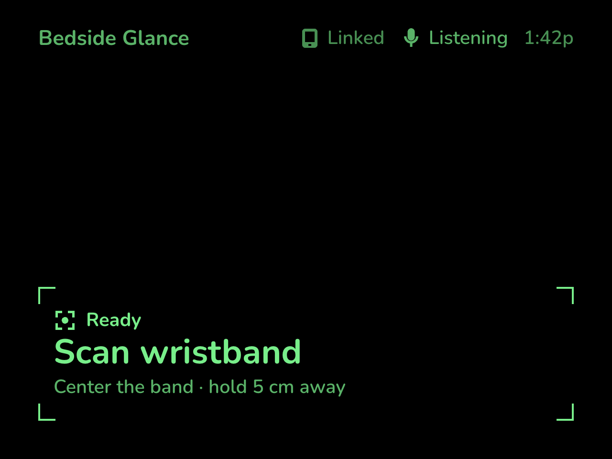
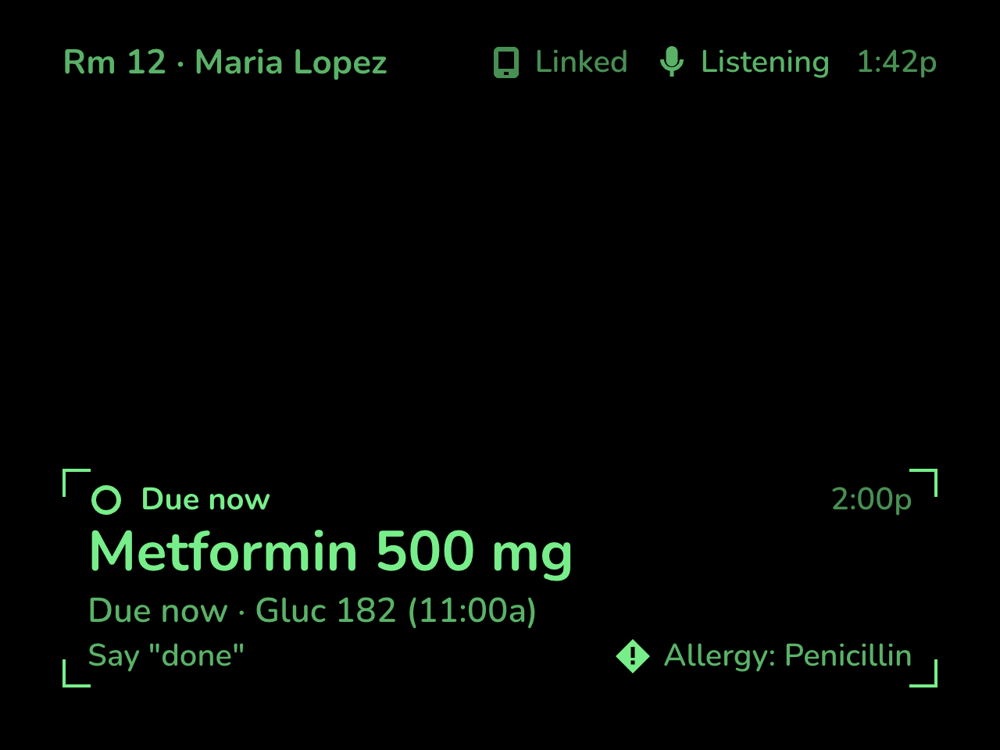
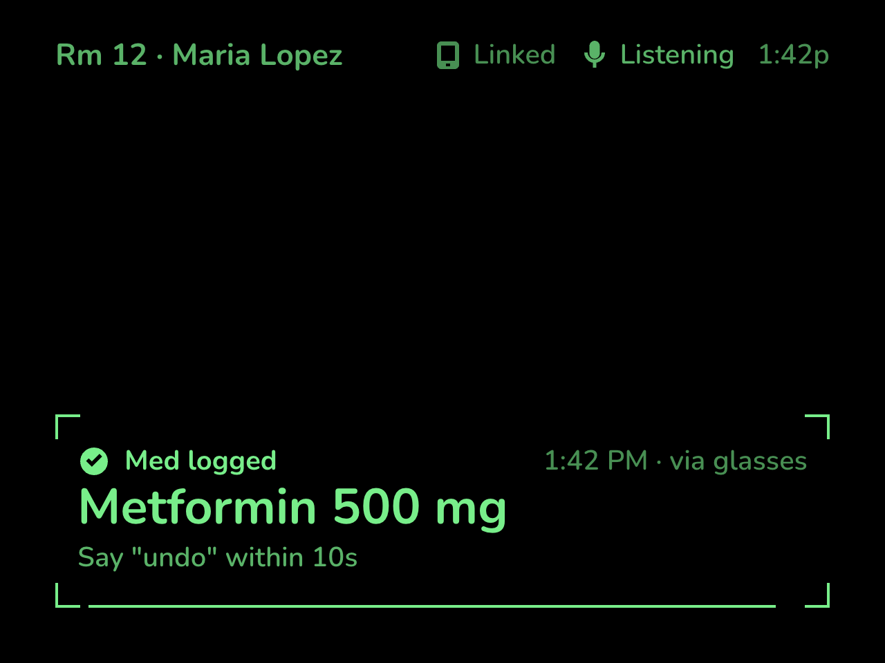
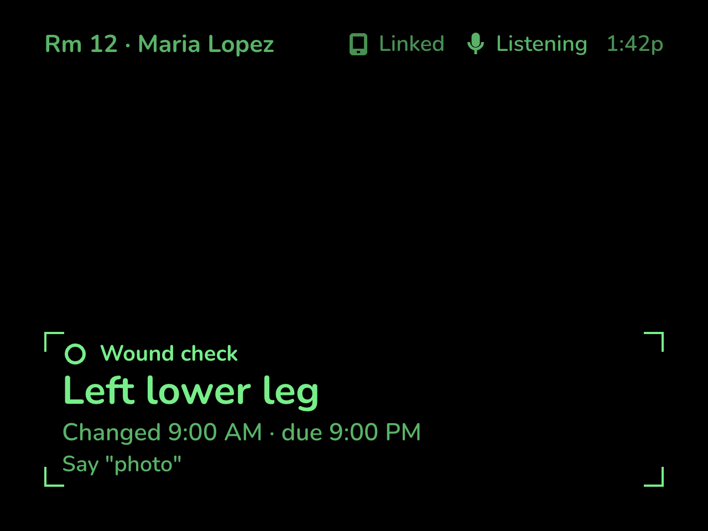
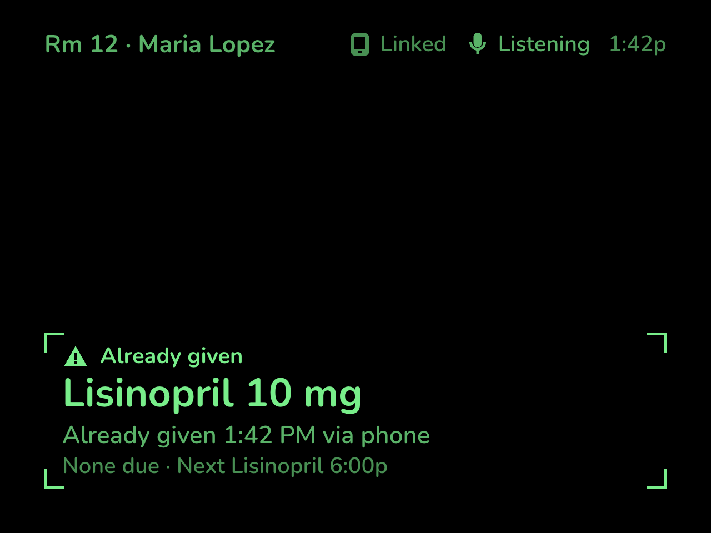
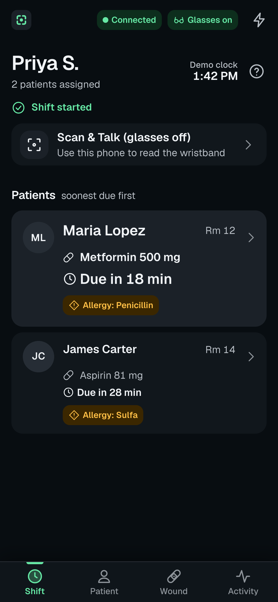
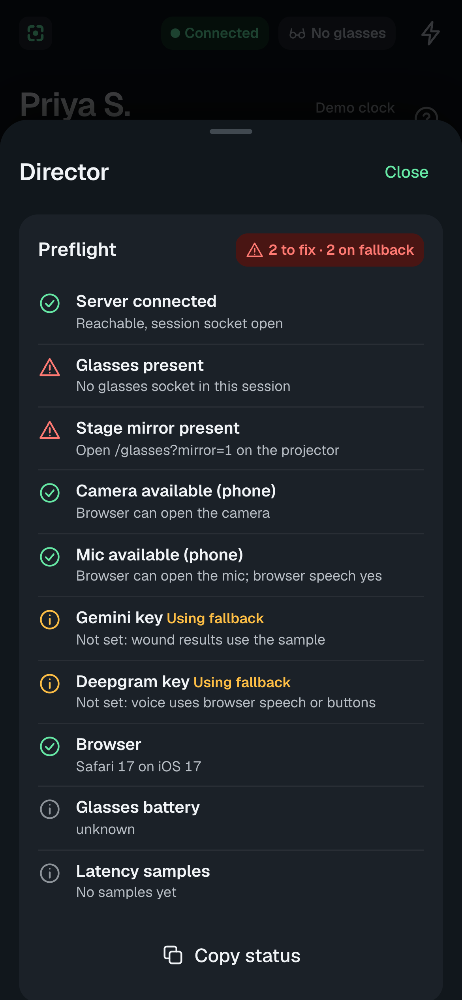
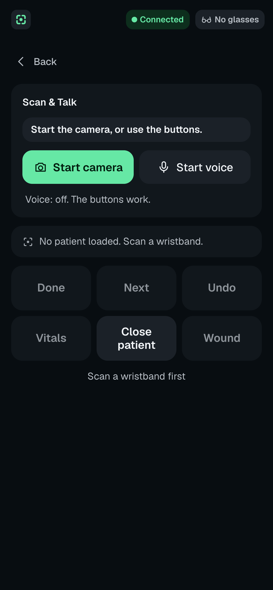
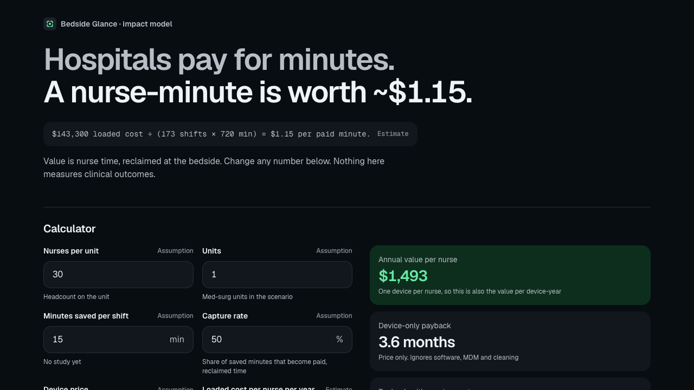
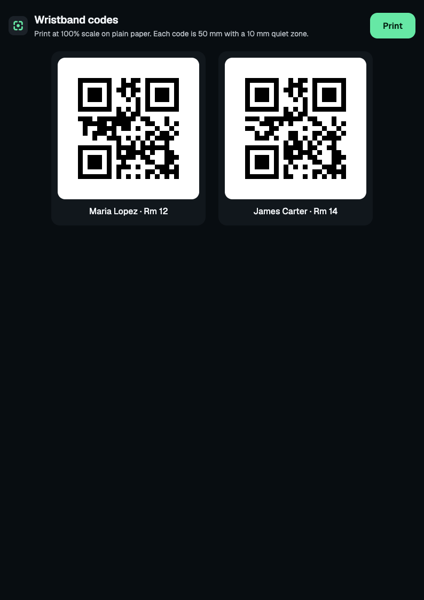

# Bedside Glance: screenshot gallery

Real captures from the production build, taken by `npm run screenshots` (headless Chrome driving the real app through the Director controls). All data is synthetic. Regenerate after any UI change.

## The glasses HUD (640x480, black = see-through)

| Idle | Scanning | Meds card |
|---|---|---|
|  |  |  |

| Med logged | PRN available | Critical allergy |
|---|---|---|
|  |  |  |

| Wound prompt | Wound assessment | Conflict banner |
|---|---|---|
|  |  |  |

Color theme and stage mirror:

| Color theme | Stage mirror (`?mirror=1`) |
|---|---|
|  |  |

## The phone (390x844)

| My shift | Patient detail | Wound review | Activity feed |
|---|---|---|---|
|  |  |  |  |

| Director drawer + preflight | Scan & Talk (Plan B) |
|---|---|
|  |  |

## The business case page (`/impact`)

| Desktop / projector | Phone |
|---|---|
|  |  |

## Printable wristband codes (`/qr`)

